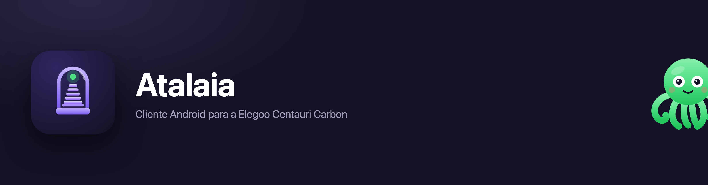

# Atalaia

**Português** · [English](#english)

**[Descarregar o APK](https://github.com/Hawaii-005/atalaia/releases/latest)** · [Releases](https://github.com/Hawaii-005/atalaia/releases) · [Problemas](https://github.com/Hawaii-005/atalaia/issues)

**A tua impressora, à vista.** Aplicação Android para controlar e vigiar as tuas **Elegoo** — a **Centauri Carbon** (filamento) e a **Saturn 3 Ultra** (resina) — a partir da rede onde estão — sem conta, sem nuvem, sem servidor pelo meio.

A impressora fala SDCP por WebSocket (`ws://<ip>:3030/websocket`) e a câmara serve MJPEG em `http://<ip>:3031/video`. A app liga-se directamente a esses dois endereços. Nada sai da tua rede, excepto quando escolhes a ligação remota por Tailscale.

Este projecto começou como fork do [CC-Tool](https://github.com/WalkerFrederick/CC-Tool) e foi muito além do original: mudou de nome, de identidade e de âmbito. Não tem qualquer afiliação, apoio ou recomendação da Elegoo.

---

## Capturas

| Início | Ficheiros (lista) |
|---|---|
| 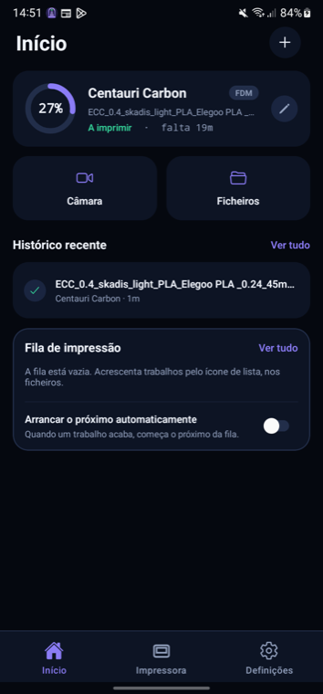 | 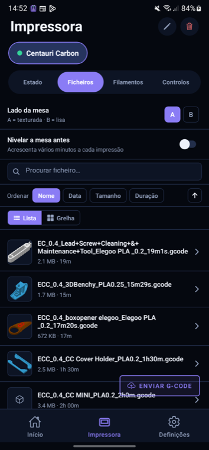 |

| Ficheiros (grelha) | Detalhe do ficheiro |
|---|---|
| 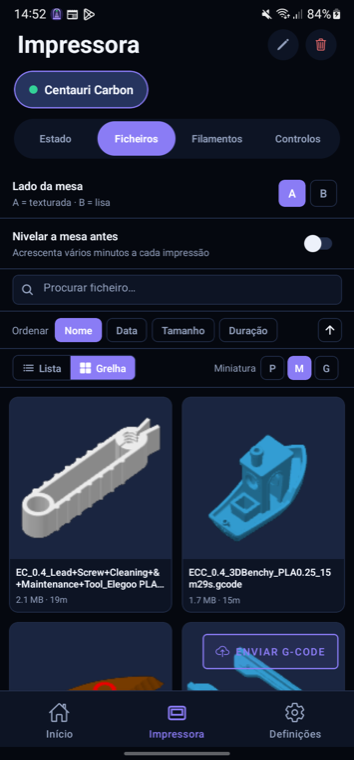 | 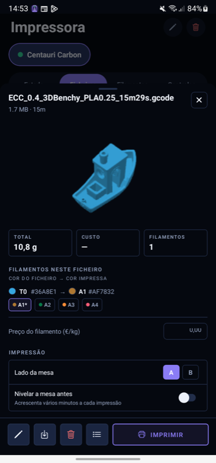 |

| Câmara | Controlos |
|---|---|
| 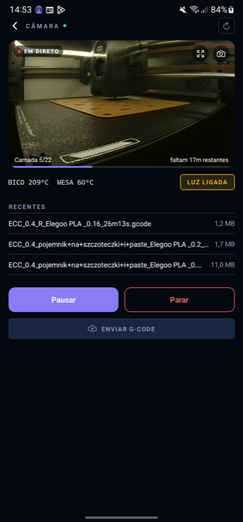 | 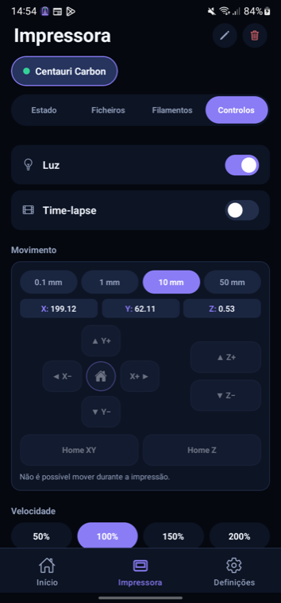 |

| Temas | Histórico |
|---|---|
| 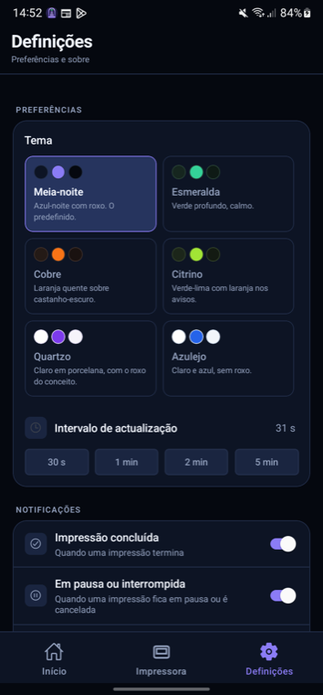 | 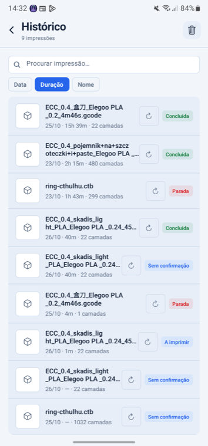 |

| Saturn 3 Ultra (resina) | Fila de impressão |
|---|---|
| 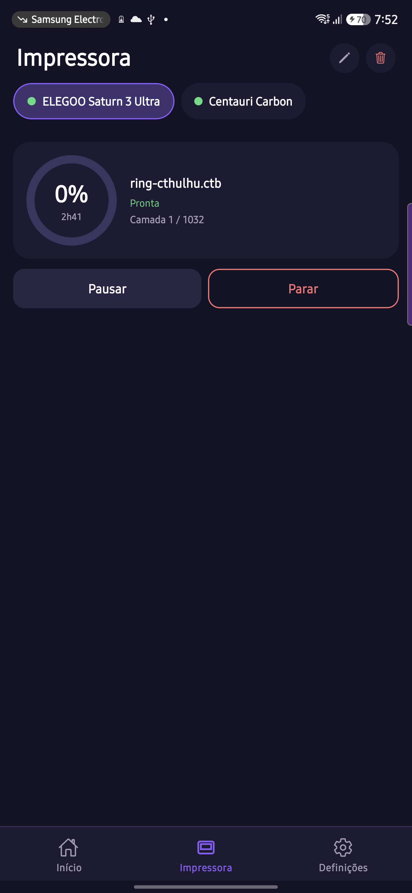 | 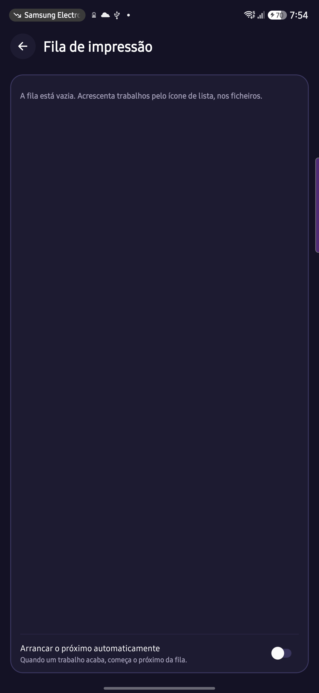 |

---

## O que faz

**Ligação**
- Descoberta automática por UDP (`M99999` na porta 3000) e entrada manual de IP ou nome de anfitrião.
- Endereço alternativo opcional por impressora — usado quando o principal não responde (ex.: Tailscale, fora de casa).
- Reconexão com espera progressiva, sem duplicar ligações, e limpeza de timers ao sair.
- Todos os pedidos de impressão esperam pelo `Ack`; uma recusa é mostrada em português, não engolida.

**Estado**
- Mapa de estados do firmware: parada, preparação, aquecimento, nivelamento, impressão, pausa, a parar, terminada.
- Pausa detectada por ticks parados, não só pelo código de estado (o firmware usa `20` para pausa *e* para nivelamento).
- Faixa de “último estado conhecido às HH:MM” quando a ligação cai — em vez de números que parecem vivos.
- Temperaturas do bico, mesa e câmara; camada actual; progresso; tempo restante.

**Impressão**
- Enviar G-code do telemóvel por HTTP em blocos de 1 MB, com tempo limite e limpeza de ficheiros temporários.
- Listar, pré-visualizar e imprimir ficheiros da máquina; ecrã de detalhe com miniatura, cores, camadas e custo.
- Ficheiros com procura por nome, vista em lista ou grelha, tamanho de miniatura (P/M/G) e ordem por data, nome, tamanho ou duração — a escolha fica guardada.
- Histórico com procura, ordem por data, duração ou nome, agrupado por Hoje / Ontem / data, e a duração lida do nome do ficheiro.
- Fila de trabalhos com arranque automático **opcional**; o trabalho só sai da fila depois de a máquina aceitar o comando, e há uma pausa de 2 minutos para o mesmo fim não arrancar dois itens.
- Pausar, retomar, parar; luz da câmara; ventoinhas por percentagem; presets PLA / ABS / silencioso.
- Reimprimir a partir do histórico, verificando primeiro se o ficheiro ainda está na máquina.

**Resina (Saturn 3 Ultra)**
- SDCP por TCP (porta 3000): estado, camada, tempo restante e o trabalho em curso.
- Pausar, retomar e parar — só depois do `Ack` da máquina; a prova é o `PrintInfo.Status` a 14 com a camada congelada.
- Enviar `.ctb`, imprimir e desligar a máquina.
- Uma ligação de cada vez: com a app aberta noutro aparelho, o SDCP recusa o segundo cliente e o ecrã diz exactamente isso. Nada de câmara, time-lapse ou filamentos onde a máquina não os tem.

**Vigia**
- Avisos com botões: **Pausar**, **Parar** e **Ver câmara**, mesmo com a app em segundo plano.
- Serviço em primeiro plano durante a impressão, para o Android não matar a app a meio.
- Marcos de progresso, conclusão, pausa e impressora offline (este último só a meio de um trabalho).

**Câmara**
- Vídeo ao vivo dentro de um anel de progresso, com ecrã inteiro e captura de fotografia.
- Modo de poupança de dados: fotografia a cada 2 s em vez de ~1 MB/s de MJPEG.

**Organização**
- Seis temas (Meia-noite, Esmeralda, Cobre, Citrino, Quartzo e Azulejo — dois claros) só com tokens: cor, tipografia, raio e densidade.
- Interface em português e inglês, com queda para português quando falta uma chave.
- Histórico local com resultado, duração, gramas e custo; estatísticas agregadas.
- Preço por quilo configurável; custo por peça calculado a partir das gramas.
- Cópia de segurança: exportar e restaurar impressoras e definições em JSON.

---

## O que mudou em relação ao CC-Tool

O fork não é uma camada de pintura sobre o original: herdou o protocolo e a estrutura, e depois foi reescrito por dentro, versão a versão (1.13 → 2.0.0).

- **Identidade própria**: nome, ícone (torre de vigia com farol), splash, textos e ecrãs de boas-vindas. O antigo nome e marca desapareceram da interface.
- **Package Android próprio** (`io.github.hawaii005.atalaia`), para não colidir com o original nem herdar a assinatura dele. A 2.0.0 é uma instalação nova, sem herdar dados de versões anteriores.
- **Câmara reconstruída**: anel de progresso em SVG com o vídeo lá dentro, recorte circular, ecrã inteiro e captura 16:9.
- **Notificações accionáveis** por categoria, com botões que não abrem a app.
- **Guardar no telemóvel**: o `.gcode` é descarregado da impressora por HTTP, com
  percentagem, e entregue ao menu do sistema (Ficheiros, Drive, Quick Share). A app
  não escreve directamente em Downloads — o Android não o permite sem permissões.
- **Fila de impressão** persistida, com arranque automático opcional e aviso em caso de falha.
- **Erros do protocolo traduzidos**: cada `Ack` tem uma explicação e uma sugestão.
- **Rede mais barata**: descoberta por um único datagrama, single-flight, e cura de IP limitada (app à frente, nunca a imprimir).
- **Consumo estimado**: quando o fatiador não declara `filament used [g]`, o E do G-code é somado e convertido em gramas pela densidade do material.
- **Temas como tokens**, não como ecrãs paralelos.
- **Testes** das funções puras que já causaram bugs (estados, pausa, Ack, consumo).
- **Serviço em primeiro plano** e ponte nativa em Kotlin.
- **Cópia de segurança** e **modo remoto**.
- **Logs só em desenvolvimento** e sem `console.log` em release.

---

## Protocolo (resumo)

| Comando | Para quê |
|---|---|
| `128` | Imprimir um ficheiro (`Filename` exactamente como o `258` devolve) |
| `129` / `131` / `130` | Pausar / retomar / parar |
| `258` | Listar ficheiros |
| `257` | Renomear (o firmware aceita e não faz nada — a app resolve no cliente) |
| `320` / `321` | Histórico: lista de ids e detalhe |
| `403` | Ventoinhas (`TargetFanSpeed`) e luz (`LightStatus.SecondLight`) |

Códigos de estado observados no firmware 1.4.49: `0` parada · `1/16/20` preparação, aquecimento, nivelamento (**20 também em pausa**) · `13` arranque de camada · `5` transição · `6` a imprimir · `7` a parar · `8` parada · `9` terminada.

---

## Compilar

Precisas de Node, JDK 21 e o Android SDK (build-tools 35).

```bash
npm install
cd android && ./gradlew assembleRelease
```

A assinatura lê `android/keystore.properties` (fora do repositório):

```
storeFile=/caminho/para/atalaia.keystore
storePassword=...
keyAlias=atalaia
keyPassword=...
```

Sem esse ficheiro a build usa a chave de debug do Android.

Testes:

```bash
npm test
```

Cobrem os comandos SDCP, os estados da impressora, o parsing do G-code, o
registo da câmara e os slots do CANVAS — 112 testes em `tests/`.

---

## Limitações conhecidas

- **Só Android.** O iOS está fora do âmbito: existe no papel, nunca foi compilado nem assinado.
- **A impressora não autentica.** Quem estiver na mesma rede pode falar com ela; a app não inventa segurança que o protocolo não tem. Não exponhas a porta 3030 à internet — usa Tailscale ou uma VPN.
- **Gramas são estimativa** quando não vêm do fatiador; o firmware devolve `EstFilamentLength` a zero e o histórico não traz consumo.
- **O espaço livre da impressora não existe no `Cmd 258`** — a app não o mostra porque não o pode saber.
- **Controlo de temperatura** não está implementado (o firmware stock não expõe comando utilizável).
- **Pausa/retomar** depende do estado interno da máquina; quando fica inconsistente, o corte de corrente na tomada é o que o limpa.
- **Renomear** é feito no cliente (descarregar, enviar, apagar), não pelo protocolo.
- **Gerir bobinas CANVAS** (criar, editar, apagar) não é possível: a interface web
  oficial só lê o `Cmd 324`. A edição existe no ecrã da impressora, não no protocolo.
- **O vídeo do time-lapse** (`Cmd 323`) está implementado e o botão aparece no
  histórico, mas **nunca foi visto a funcionar**: a impressora não tinha vídeos.
  Com um `Url` inválido o firmware responde `Ack 1`. O caminho relativo devolvido
  é completado com o IP da impressora.

---

## Privacidade

A app não tem contas, telemetria nem analítica. Guarda localmente as impressoras, o histórico, o preço por quilo e as preferências. A única comunicação é com a impressora, no endereço que configuras.

---

## Licença e créditos

MIT — ver [LICENSE](LICENSE).

- Original: **CC-Tool**, de Frederick Walker, também MIT. Sem ele, este fork não existia.
- Protocolo SDCP documentado pela comunidade Elegoo.
- Atalaia é um projecto independente, sem afiliação com a Elegoo.

---

# English

**[Download the APK](https://github.com/Hawaii-005/atalaia/releases/latest)** · [Releases](https://github.com/Hawaii-005/atalaia/releases) · [Issues](https://github.com/Hawaii-005/atalaia/issues)

**Your printer, in sight.** An Android app to control and watch your **Elegoo** printers — the **Centauri Carbon** (filament) and the **Saturn 3 Ultra** (resin) — from the network they live on — no account, no cloud, no server in between.

The printer speaks SDCP over WebSocket (`ws://<ip>:3030/websocket`) and the camera serves MJPEG at `http://<ip>:3031/video`. The app talks to those two addresses directly. Nothing leaves your network, except when you choose the remote connection over Tailscale.

This project started as a fork of [CC-Tool](https://github.com/WalkerFrederick/CC-Tool) and went well past the original: new name, new identity, new scope. Not affiliated with, endorsed or recommended by Elegoo in any way.

## Screenshots

Same images as above — the interface is localised, so the Portuguese shots show exactly what the app looks like in Portuguese.

| Home | Detail |
|---|---|
|  |  |

| Camera | Settings |
|---|---|
|  |  |

| Movement | Mascot (no connection) |
|---|---|
|  | 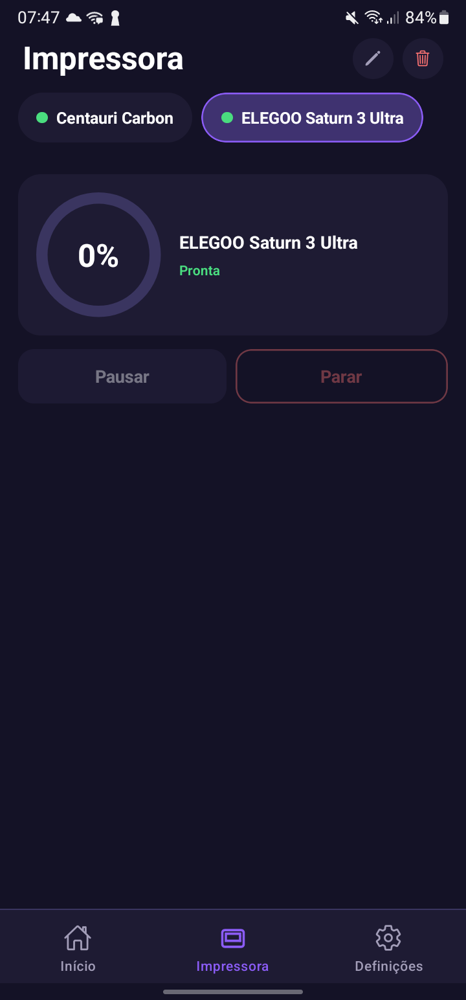 |

## What it does

**Connection**
- Automatic discovery over UDP (`M99999` on port 3000) and manual entry of an IP or hostname.
- Optional alternate address per printer, used when the main one does not answer (e.g. Tailscale, away from home).
- Reconnection with backoff, no duplicate sockets, and timers cleaned up on exit.
- Every print request waits for the `Ack`; a refusal is shown in plain language instead of being swallowed.

**State**
- Firmware state map: idle, preparing, heating, levelling, printing, paused, stopping, finished.
- Pause detected from stalled ticks, not just the status code (the firmware uses `20` for both pause *and* levelling).
- “Last known state at HH:MM” banner when the link drops — instead of numbers that look live.
- Nozzle, bed and chamber temperatures; current layer; progress; time left.

**Printing**
- Send G-code from the phone over HTTP in 1 MB chunks, with a timeout and temporary-file cleanup.
- List, preview and print files on the machine; detail screen with thumbnail, colours, layers and cost.
- Print queue with **optional** auto-start (off by default).
- Pause, resume, stop; chamber light; fan percentages; PLA / ABS / quiet presets.
- Reprint from history, checking first that the file is still on the machine.

**Watching**
- Notifications with buttons: **Pause**, **Stop** and **View camera**, even with the app in the background.
- Foreground service while printing, so Android does not kill the app mid-job.
- Progress milestones, completion, pause and printer-offline (the latter only mid-job).

**Camera**
- Live video inside a progress ring, with fullscreen and photo capture.
- Data-saving mode: one photo every 2 seconds instead of ~1 MB/s of MJPEG.

**Organisation**
- Six themes (Midnight, Esmeralda, Cobre, Citrino, Quartzo, Azulejo — two of them light) built only from tokens: colour, typography, radius and density.
- Portuguese and English, falling back to Portuguese when a key is missing.
- Local history with outcome, duration, grams and cost; aggregate statistics.
- Configurable price per kilogram; per-part cost computed from grams.
- Backup: export and restore printers and settings as JSON.

## What changed from CC-Tool

This fork is not a coat of paint over the original: it inherited the protocol and structure, then was rewritten from the inside, version after version (1.13 → 2.0.0).

- **Its own identity**: name, icon (a watchtower with a beacon), splash, texts and welcome screens. The old name and branding are gone from the interface.
- **Its own Android package** (`io.github.hawaii005.atalaia`), so it neither collides with the original nor inherits its signature. Version 2.0.0 installs as a new app and keeps no data from earlier versions.
- **Camera rebuilt**: SVG progress ring with the video inside, circular crop, fullscreen and 16:9 capture.
- **Actionable notifications** by category, with buttons that do not open the app.
- **Print queue** persisted, with optional auto-start and a warning when a job fails to start.
- **Protocol errors translated**: every `Ack` has an explanation and a suggestion.
- **Cheaper networking**: single-datagram discovery, single-flight, and IP healing limited to the foreground and never while printing.
- **Estimated consumption**: when the slicer does not declare `filament used [g]`, the G-code E values are summed and converted to grams using the material density.
- **Themes as tokens**, not parallel screens.
- **Tests** for the pure functions that have already caused bugs (states, pause, Ack, consumption).
- **Foreground service** and a small Kotlin bridge.
- **Backup** and **remote mode**.
- **Logs only in development** and no `console.log` in release.

## Protocol (summary)

| Command | Purpose |
|---|---|
| `128` | Start a file (`Filename` exactly as returned by `258`) |
| `129` / `131` / `130` | Pause / resume / stop |
| `258` | List files |
| `257` | Rename (the firmware accepts it and does nothing — the app works around it on the client) |
| `320` / `321` | History: id list and detail |
| `403` | Fans (`TargetFanSpeed`) and light (`LightStatus.SecondLight`) |

Status codes observed on firmware 1.4.49: `0` idle · `1/16/20` preparing, heating, levelling (**20 also means paused**) · `13` layer change · `5` transition · `6` printing · `7` stopping · `8` stopped · `9` finished.

## Building

You need Node, JDK 21 and the Android SDK (build-tools 35).

```bash
npm install
cd android && ./gradlew assembleRelease
```

Signing reads `android/keystore.properties` (not in the repository):

```
storeFile=/path/to/atalaia.keystore
storePassword=...
keyAlias=atalaia
keyPassword=...
```

Without that file the build falls back to the Android debug key.

Tests:

```bash
npm test
```

## Known limitations

- **Android only.** iOS is out of scope: the project exists on paper but has never been built or signed.
- **The printer does not authenticate.** Anyone on the same network can talk to it; the app does not invent security the protocol lacks. Do not expose port 3030 to the internet — use Tailscale or a VPN.
- **Grams are an estimate** when they do not come from the slicer; the firmware reports `EstFilamentLength` as zero and the history carries no consumption.
- **Free space is not in `Cmd 258`** — the app does not show it because it cannot know it.
- **Temperature control** is not implemented (the stock firmware exposes no usable command).
- **Pause/resume** depends on the machine's internal state; when it gets stuck, power-cycling the smart plug is what clears it.
- **Renaming** is done on the client (download, upload, delete), not through the protocol.

## Privacy

No accounts, no telemetry, no analytics. Printers, history, price per kilogram and preferences are stored locally. The only traffic is to the printer, at the address you configure.

## Licence and credits

MIT — see [LICENSE](LICENSE).

- Original: **CC-Tool**, by Frederick Walker, also MIT. Without it this fork would not exist.
- SDCP protocol documented by the Elegoo community.
- Atalaia is an independent project, not affiliated with Elegoo.
